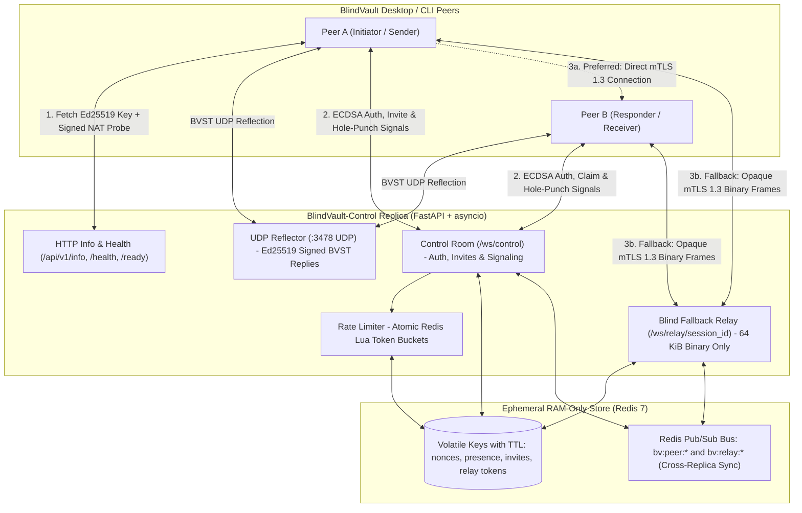

# BlindVault-Control — Complete Non-Technical Project Guide

Welcome to the plain-English guide to **BlindVault-Control**.  
This document explains what the **BlindVault-Control** server does, how every part of the control plane works together from start to finish, and what every single file in this repository is responsible for—without requiring a cryptography, networking, or backend-engineering background.

---

## 1. What Problem Does `blindvault-control` Solve?

When two people or offices run **BlindVault** to exchange sensitive files directly across the internet, they immediately run into three real-world networking headaches:

1. **Hidden Addresses (NAT & Firewalls):** Most home and corporate computers sit behind routers and firewalls. Your computer usually only knows its local office address (like `192.168.1.25`), not the public internet address other computers need to reach it.
2. **Hard-to-Share Identities:** BlindVault identifies every computer using a 64-character cryptographic fingerprint. Reading or typing 64 random hex characters over the phone or chat just to start a transfer is slow and error-prone.
3. **Strict Corporate Firewalls:** Even when two computers know each other's public address, strict corporate firewalls (symmetric NAT) often block direct peer-to-peer connections completely.

**BlindVault-Control** solves all three problems **without ever being trusted with your data**:
* It tells each computer its real public internet address—with a tamper-proof digital stamp so nobody on the network can forge it.
* It matches two computers using a short, human-friendly **8-character invite code** (like `NJ4KW887`).
* If firewalls still block a direct link, it acts as a **blind relay** that passes already-encrypted data between the two computers without ever being able to open, inspect, or even log who talked to whom permanently.

### A Real-World Analogy

Think of **BlindVault-Control** as a **blind postal switchboard operator** running a room with **no filing cabinets and no paper trail**:

1. **The Doorbell Check (UDP Reflector):** Before calling anyone, Alice steps up to the switchboard's side window and asks, *"What return address does my envelope show on the outside?"* The operator writes down Alice's public IP and port, stamps it with the switchboard's official wax seal (Ed25519 signature), and hands it back so Alice knows nobody lied about her address.
2. **Showing Your Passport Without a Password (Auth):** Alice dials into the switchboard (`/ws/control`). Instead of asking for a username, email, or password, the operator hands her a one-time random slip of paper (`CHALLENGE`). Alice stamps it with her private key. The operator verifies the stamp and immediately shreds the slip so it can never be reused.
3. **Meeting via an 8-Character Room Code (Pairing):** Alice asks for a temporary 5-minute meeting room code (`NJ4KW887`) and sends it to Bob over Signal, Slack, or phone. Bob walks up to the switchboard, reads out `NJ4KW887`, and the operator introduces Alice and Bob—immediately shredding the room code as soon as Bob uses it.
4. **Stepping Outside vs. Passing Locked Boxes (Direct vs. Blind Relay):** Alice and Bob first try to step outside and hand files directly to each other. If a brick wall (strict firewall) separates them, they ask the operator for a temporary conveyor belt (`/ws/relay/{session_id}`). Alice sends **double-locked steel boxes (end-to-end mTLS 1.3)** down the belt, and Bob unlocks them on the other side. The operator only moves opaque boxes—it never sees the filenames, the contents, or the encryption keys.
5. **Amnesia by Design (RAM-Only State & Log Scrubbing):** The switchboard keeps all active room codes and presence notes strictly in **volatile memory (Redis with disk saving disabled)**. When a session ends—or times out after a few seconds or minutes—everything vanishes automatically. Even diagnostic server logs automatically scrub IP addresses into `[REDACTED_IP]`.

---

## 2. How Everything Connects (The Big Picture)

---

## 3. Step-by-Step Pipeline: From Start to Finish

### Pipeline A: Discovering Your Public Address (`GET /api/v1/info` + `udp_reflector.py`)
1. **Fetch the Server's Public Stamp (`GET /api/v1/info`):** Before asking the server for its public IP address, a BlindVault client calls `/api/v1/info` over HTTPS to learn the server's **32-byte Ed25519 public key** (`udp_reflector_public_key`) along with protocol limits and version info.
2. **Send a Tiny 20-Byte UDP Probe (`BVST`):** The client sends a 20-byte UDP packet to port `3478` containing the 4-byte magic header `BVST` (`0x42565354`) followed by a fresh 16-byte random nonce.
3. **Receive a Tamper-Proof Reply:** `udp_reflector.py` packs the client's observed public IP (IPv4 or IPv6), observed UDP port, echoed 16-byte nonce, and current server timestamp into a compact binary response (99 bytes for IPv4, 111 bytes for IPv6) and signs the entire payload with its **Ed25519 private key** (64-byte signature).
4. **Verify Locally:** Because the client checks the Ed25519 signature and echoed nonce locally, an attacker sitting on a Wi-Fi router cannot spoof a fake external IP/port or replay an old reflection packet.

### Pipeline B: Passwordless Authentication & Presence (`signaling.py` + `crypto.py`)
1. **Origin & Frame Guards:** When a client opens a WebSocket to `/ws/control`, `signaling.py` first checks the browser `Origin` allow-list (if configured), checks the IP rate limit (`10 handshakes/min`), and enforces a strict **8 KiB ceiling** on every JSON control message.
2. **Strict Curve Enforcement (`HELLO`):** The client sends its public key (`PEM` or `DER`). `crypto.py` strictly accepts only **EC P-256 (`SECP256R1`)** keys—rejecting RSA, `secp256k1`, `secp384r1`, or malformed keys—and computes the peer's canonical lowercase 64-character SHA-256 SPKI DER **fingerprint**.
3. **One-Time Challenge (`CHALLENGE` -> `AUTH` -> `AUTH_OK`):**
   - The server generates a 32-byte cryptographically random nonce (`secrets.token_bytes`) and stores it in Redis under `nonce:{fingerprint}` with a **30-second TTL**.
   - The client signs the raw nonce bytes using its private key (ECDSA-SHA256) and sends the signature back in `AUTH`.
   - The server retrieves and **atomically deletes** the nonce in a single Redis `GETDEL` command—making replay attacks impossible even under parallel requests—then verifies the signature.
4. **Ephemeral Presence & Heartbeats (`PING` / `PONG`):** Once authenticated, the peer is marked online in Redis (`presence:{fingerprint}`, **60-second TTL**). The client sends a `PING` every ~20 seconds to keep its presence alive; if the client disconnects or goes quiet, Redis automatically deletes its presence key.

### Pipeline C: Zero-Knowledge Room Codes & Matchmaking (`signaling.py` + `redis_store.py`)
1. **Create an 8-Character Code (`CREATE_INVITE`):** The initiator requests a pairing invite (rate-limited to `10/min` per fingerprint) and may optionally declare endpoint hints. `crypto.py` generates an 8-character **Crockford Base32** code (using alphabet `0123456789ABCDEFGHJKMNPQRSTVWXYZ`, intentionally omitting ambiguous characters `I`, `L`, `O`, and `U`).
2. **Short-Lived Storage:** Redis stores the invite under `invite:{code}` with a **300-second (5-minute) TTL**.
3. **Atomic Single-Use Claim (`CLAIM_INVITE`):**
   - The responder sends the code (automatically normalized—so accidental `i`/`l` become `1`, `o` becomes `0`, and hyphens/spaces are stripped).
   - Both the responder's fingerprint and IP are checked against rate limits (`10/min`) to stop brute-force guessing.
   - The server reads and **atomically consumes** the invite via Redis `GETDEL` so no second person can ever reuse it, and explicitly blocks self-pairing (`initiator == responder`).
4. **Zero-Knowledge Introduction (`PEER_MATCHED`):** Both peers receive a `PEER_MATCHED` message containing their partner's fingerprint and **only the endpoints explicitly declared by the partner**—never the server's internally observed socket IP.
5. **Hole-Punch Coordination:** Peers can then exchange `SIGNAL_OFFER`, `SIGNAL_ANSWER`, and `HOLE_PUNCH_SYNC` messages to coordinate a direct peer-to-peer connection.

### Pipeline D: Blind Binary Fallback Relay (`relay.py` + `main.py`)
1. **Open a Relay Session (`CREATE_RELAY`):** If firewalls block a direct connection (or `--force-relay` is enabled), the initiator asks `/ws/control` to allocate a relay session (`5/min` per fingerprint). The server creates a unique `session_id` and two distinct **single-use 30-second tokens**—one bound to the initiator (`RELAY_CREATED`) and one forwarded to the responder (`RELAY_INVITE`).
2. **Private Token Presentation:** Both peers connect to `/ws/relay/{session_id}` and supply their token via `Authorization: Bearer <token>` (preferred, avoiding URL/proxy logs), `X-Relay-Token`, `Sec-WebSocket-Protocol: token-<token>`, or `?token=` fallback.
3. **Strict Frame & Session Enforcement:**
   - Each token can claim its designated slot (`initiator` or `responder`) **only once** (atomic Redis claim; invalid or duplicate tokens close with WebSocket code `1008`).
   - Only **binary frames** up to **64 KiB (`65,536` bytes)** are allowed. Sending text frames closes the connection with `1003` (Unsupported Data); oversized frames close with `1009` (Message Too Big).
   - Sessions enforce a **30-second idle timeout** and a **900-second (15-minute) maximum lifetime**, and clean up immediately if either peer disconnects early.
4. **End-to-End Opaque Tunnel:** Inside those binary frames, the two BlindVault peers run their own **mutual TLS 1.3 handshake** directly with each other. `blindvault-control` blindly copies raw ciphertext bytes from A to B and B to A—never terminating TLS and never reading a single byte of plaintext.

### Pipeline E: Horizontal Multi-Replica Scaling & Abuse Protection (`redis_store.py` + `rate_limiter.py`)
1. **Multiple Servers Acting as One:** Because every replica connects to the same Redis instance, Peer A can be connected to Server #1 while Peer B is connected to Server #2:
   - **Signaling Across Replicas:** Each replica subscribes to `bv:peer:{fingerprint}` on Redis Pub/Sub for its locally connected peers. When Peer A sends an invite claim or `SIGNAL_OFFER` to Peer B on another server, Server #1 publishes it to `bv:peer:{B}` and Server #2 delivers it instantaneously.
   - **Relaying Across Replicas:** If both peers land on the *same* replica, `relay.py` pipes bytes directly in memory (`pipe_stream`). If they land on *different* replicas, `bridge_via_redis_pubsub` transparently bridges binary frames across Redis Pub/Sub channels (`bv:relay:{session_id}:ctrl`, `:a2b`, and `:b2a`).
2. **Atomic Lua Token Buckets (`rate_limiter.py`):** Rate limits execute inside a single atomic Redis Lua script (`TOKEN_BUCKET_LUA`) so concurrent bursts across multiple replicas cannot bypass quotas.
3. **IP-Scrubbed Structured Logs (`main.py`):** `structlog` outputs JSON logs passed through `ip_scrubbing_processor`, which automatically regex-redacts IPv4 and IPv6 addresses to `[REDACTED_IP]` whenever `BLINDVAULT_SCRUB_IPS_IN_LOGS=true` (the default).

---

## 4. Complete File-by-File Reference

Root directory: `z:\home\omar-25th\projects\blindvault-control`

### Packaging, Configuration & Deployment
| File | What It Does & Its Role in the Pipeline |
| :--- | :--- |
| `pyproject.toml` | Project manifest and build config (`setuptools`). Declares Python `>=3.12` dependencies (`fastapi`, `uvicorn[standard]`, `websockets`, `cryptography`, `redis`, `pydantic`, `pydantic-settings`, `structlog`), dev tools (`pytest`, `pytest-asyncio`, `httpx`, `fakeredis[lua]`, `numpy`, `ruff`, `mypy`), strict typing/linting settings, and registers the `blindvault-control` CLI entry point (`blindvault_control.main:run`). |
| `Dockerfile` | Multi-stage container build based on `python:3.12-slim`. Stage 1 builds wheels; Stage 2 installs them cleanly, runs as an unprivileged `blindvault` user (UID/GID `10001`), exposes `8000/tcp` and `3478/udp`, wires a `/ready` container health check, and launches `blindvault-control`. |
| `docker-compose.yml` | Local and production-ready container stack pairing `redis:7-alpine` (explicitly configured with `--appendonly no --save ""` for **zero disk persistence**) with the `blindvault-control` service, health checks, and port mappings (`8000/tcp`, `3478/udp`). |
| `README.md` | Developer documentation covering architecture, zero-knowledge guarantees, wire protocol specs (`/ws/control`, `/ws/relay/{session_id}`, `BVST` UDP packet layout), configuration variables, benchmarks, and deployment commands. |
| `PROJECT_EXPLAINED.md` | This plain-English, non-technical architectural guide and complete file-by-file reference. |

### Branding & Interactive Showcase Website (`assets/` & `docs/`)
| File | What It Does & Its Role in the Pipeline |
| :--- | :--- |
| `assets/logo-mark.svg` | Standalone square vector icon mark for BlindVault-Control used in repository documentation and UI headers. |
| `assets/logo.svg` | Full horizontal BlindVault-Control wordmark + vector emblem used in `README.md` and branding surfaces. |
| `docs/index.html` | Interactive showcase and documentation website for `blindvault-control` explaining the control plane architecture, UDP reflector, pairing flow, relay tunnel, and privacy model. |
| `docs/styles.css` | Visual styling, dark-mode design tokens, responsive grid layouts, and interactive diagram styles for `docs/index.html`. |
| `docs/app.js` | Client-side interactivity for the showcase site (animated protocol walkthroughs, interactive tabs, and UI controls). |
| `docs/assets/logo-mark.svg` | Web-bundled copy of the vector icon mark served directly by the `docs/` static site. |

### Core Control-Plane Modules (`src/blindvault_control/`)
| File | What It Does & Its Role in the Pipeline |
| :--- | :--- |
| `src/blindvault_control/__init__.py` | Exposes package version metadata (`__version__`) used by `/api/v1/info` and diagnostics. |
| `src/blindvault_control/config.py` | Central Pydantic `BaseSettings` configuration (`BLINDVAULT_*` env vars & `.env` file): server host/port (`0.0.0.0:8000`), UDP bind (`0.0.0.0:3478`), `UDP_SIGNING_PRIVATE_KEY`, `REDIS_URL`, `ALLOWED_ORIGINS`, rate-limit ceilings (`10/min` handshake/invite/claim, `5/min` relay), relay limits (`900s` max duration, `30s` idle timeout, `65536` byte binary cap, `8192` byte control cap), key TTLs (`60s` presence, `30s` challenge, `300s` invite, `30s` relay token, `20s` heartbeat), and `SCRUB_IPS_IN_LOGS=True`. |
| `src/blindvault_control/crypto.py` | Cryptographic gatekeeper: strictly parses **EC P-256 (`SECP256R1`)** public keys (rejecting RSA and other curves), computes canonical lowercase SHA-256 SPKI DER peer fingerprints (`compute_peer_fingerprint`), generates 32-byte CSPRNG auth challenges (`secrets.token_bytes`), verifies ECDSA-SHA256 signatures, and generates/normalizes 8-character Crockford Base32 invite codes (mapping `I`/`L` -> `1`, `O` -> `0`). |
| `src/blindvault_control/schemas.py` | Strict Pydantic v2 wire contracts for `/ws/control`: validates every Client->Server message (`HELLO`, `AUTH`, `PING`, `CREATE_INVITE`, `CLAIM_INVITE`, `SIGNAL_OFFER`, `SIGNAL_ANSWER`, `HOLE_PUNCH_SYNC`, `CREATE_RELAY`) and serializes every Server->Client response (`CHALLENGE`, `AUTH_OK`, `AUTH_FAILED`, `PONG`, `INVITE_CREATED`, `PEER_MATCHED`, `RELAY_CREATED`, `RELAY_INVITE`, `ERROR`). |
| `src/blindvault_control/redis_store.py` | Async Redis state abstraction enforcing ephemeral, TTL-bounded storage with zero SQL/disk tables: atomic single-use `GETDEL` for auth nonces (`30s`) and invite codes (`300s`), presence heartbeats (`60s`), relay session records and atomic slot claims (`claim_relay_slot`, `get_relay_slots`), and Redis Pub/Sub helpers. |
| `src/blindvault_control/rate_limiter.py` | Distributed abuse protection backed by an atomic Redis Lua token-bucket script (`TOKEN_BUCKET_LUA`). Enforces independent quotas for handshakes (per IP), invite creation (per fingerprint), invite claims (per fingerprint and per IP), and relay creation (per fingerprint). |
| `src/blindvault_control/udp_reflector.py` | Async `asyncio.DatagramProtocol` listener on UDP `:3478`. Receives 20-byte `BVST` probes (`b"BVST"` + 16-byte nonce) and replies with 99-byte (IPv4) or 111-byte (IPv6) binary packets carrying observed IP, port, echoed nonce, timestamp, and a 64-byte **Ed25519 signature** verifiable using the public key published on `/api/v1/info`. |
| `src/blindvault_control/signaling.py` | Runs `/ws/control` (`SignalingManager` and `handle_control_session`): validates `Origin` headers, enforces the 8 KiB control frame limit, drives the ECDSA challenge-response handshake, refreshes presence on `PING`, manages Crockford invite creation/claiming (blocking self-pairing and never leaking server-observed socket IPs in `PEER_MATCHED`), forwards hole-punch candidates, and routes signaling across replicas via Redis Pub/Sub (`bv:peer:{fingerprint}`). |
| `src/blindvault_control/relay.py` | Runs `/ws/relay/{session_id}` (`RelaySession`, `RelayManager`, `pipe_stream`, `bridge_via_redis_pubsub`, `handle_relay_connection`): verifies single-use 30-second tokens bound to `(initiator, responder)`, enforces binary-only frames (`1003` on text, `1009` > 64 KiB, `1008` on invalid/duplicate token), cleans up cleanly on early disconnect, enforces 30s idle / 900s max timeouts, and forwards opaque mTLS 1.3 bytes either directly in memory or across replicas via Redis Pub/Sub (`bv:relay:{session_id}:ctrl`, `:a2b`, `:b2a`). |
| `src/blindvault_control/main.py` | FastAPI application factory (`create_app()`) and Uvicorn runner (`run()`). Manages startup/shutdown lifespan (Redis connection, UDP reflector, Ed25519 key loading/generation), configures `structlog` JSON logging with `ip_scrubbing_processor` (`[REDACTED_IP]`), and exposes `/health`, `/ready`, `/api/v1/info`, `/ws/control`, and `/ws/relay/{session_id}`. |

### Benchmarks & Automated Test Suite (`benchmarks/` & `tests/`)
| File | What It Does & Its Role in Verification |
| :--- | :--- |
| `benchmarks/bench_control.py` | Standalone performance harness measuring concurrent ECDSA authentication handshake throughput/latency, 500 concurrent authenticated idle WebSocket peers with fan-out `PING`/`PONG` latency, and 100 MiB end-to-end 64 KiB-chunked binary relay throughput with SHA-256 verification. |
| `tests/__init__.py` | Marks `tests/` as a Python package for pytest discovery. |
| `tests/conftest.py` | Shared async pytest fixtures: in-memory `fakeredis[lua]` backend (supporting the real Lua rate-limiter script), test EC P-256 identities, live ASGI server fixtures, and `two_live_servers` simulating two horizontally scaled replicas sharing one Redis Pub/Sub bus. |
| `tests/test_crypto.py` | **11 tests** verifying EC P-256 PEM/DER parsing, rejection of RSA and non-P-256 curves (`secp256k1`/`secp384r1`), canonical SHA-256 SPKI fingerprints, ECDSA verification, and Crockford Base32 generation & normalization. |
| `tests/test_auth_and_presence.py` | **7 tests** verifying the full `HELLO -> CHALLENGE -> AUTH -> AUTH_OK` flow, invalid signature rejection, atomic single-use nonce replay rejection, oversized control frame rejection, `Origin` enforcement, `/ready` readiness probes, and IP scrubbing in JSON logs. |
| `tests/test_pairing_and_signaling.py` | **6 tests** verifying invite creation/claiming, single-use invite burn, self-pairing blocking, zero-knowledge endpoint privacy (no leaked server-observed IP), hole-punch signal forwarding, and cross-replica Pub/Sub signaling across `two_live_servers`. |
| `tests/test_udp_reflector.py` | **6 tests** verifying Ed25519 key formats, IPv4 and IPv6 `BVST` wire packet packing/verification, tamper detection on modified IP/port/timestamp bytes, malformed probe ignoring, and live `/api/v1/info` + UDP probe verification. |
| `tests/test_relay.py` | **6 tests** verifying 10 MiB end-to-end binary relay transfers with SHA-256 integrity, 64 KiB frame cap enforcement (`1009`), text-frame rejection (`1003`), duplicate/invalid token rejection (`1008`), early disconnect teardown, and cross-replica relay bridging over Redis Pub/Sub. |
| `tests/test_rate_limiter.py` | **5 tests** verifying atomic Redis Lua token-bucket enforcement and refill behavior for handshakes, invite creation, invite claiming, and relay creation. |

---

## 5. Privacy Guarantees & Verified Performance at a Glance

### Zero-Knowledge Guarantees
* **Zero Accounts & Zero Database:** No usernames, emails, passwords, SQL tables, or permanent peer/social graphs exist anywhere in `blindvault-control`.
* **Zero Disk Persistence:** Redis is configured with `--appendonly no --save ""` so every nonce (`30s`), presence record (`60s`), invite (`300s`), and relay token (`30s`) lives solely in RAM and evaporates automatically.
* **Zero Plaintext Access:** Relay sessions accept strictly binary frames (`<= 64 KiB`) carrying end-to-end **mTLS 1.3** between BlindVault peers—the server never holds TLS keys and never decrypts traffic.
* **Zero Unintended IP Leaks:** `PEER_MATCHED` shares only endpoints explicitly declared by the peers themselves, and server logs redact IPv4/IPv6 addresses to `[REDACTED_IP]` by default.

### Verified Test & Benchmark Summary (from `README.md`)
* **Automated Test Suite:** `41 / 41` tests passing across cryptography, auth/presence, pairing/signaling, Ed25519 UDP reflection, binary relay (single-replica & multi-replica), and Lua rate limiting.
* **ECDSA Handshake Throughput:** `185–312 handshakes/sec` (`73.8–131.8 ms` p50 latency under concurrent load).
* **Concurrent Authenticated Peers:** `500` simultaneous authenticated WebSocket peers (`135.2 ms` p50 fan-out `PING`/`PONG` latency).
* **Opaque Binary Relay Throughput:** `100 MiB` streamed in `64 KiB` frames at `8.31–9.60 MiB/s` (`~70–80.5 Mbps`) with `100%` SHA-256 integrity verified end-to-end.
