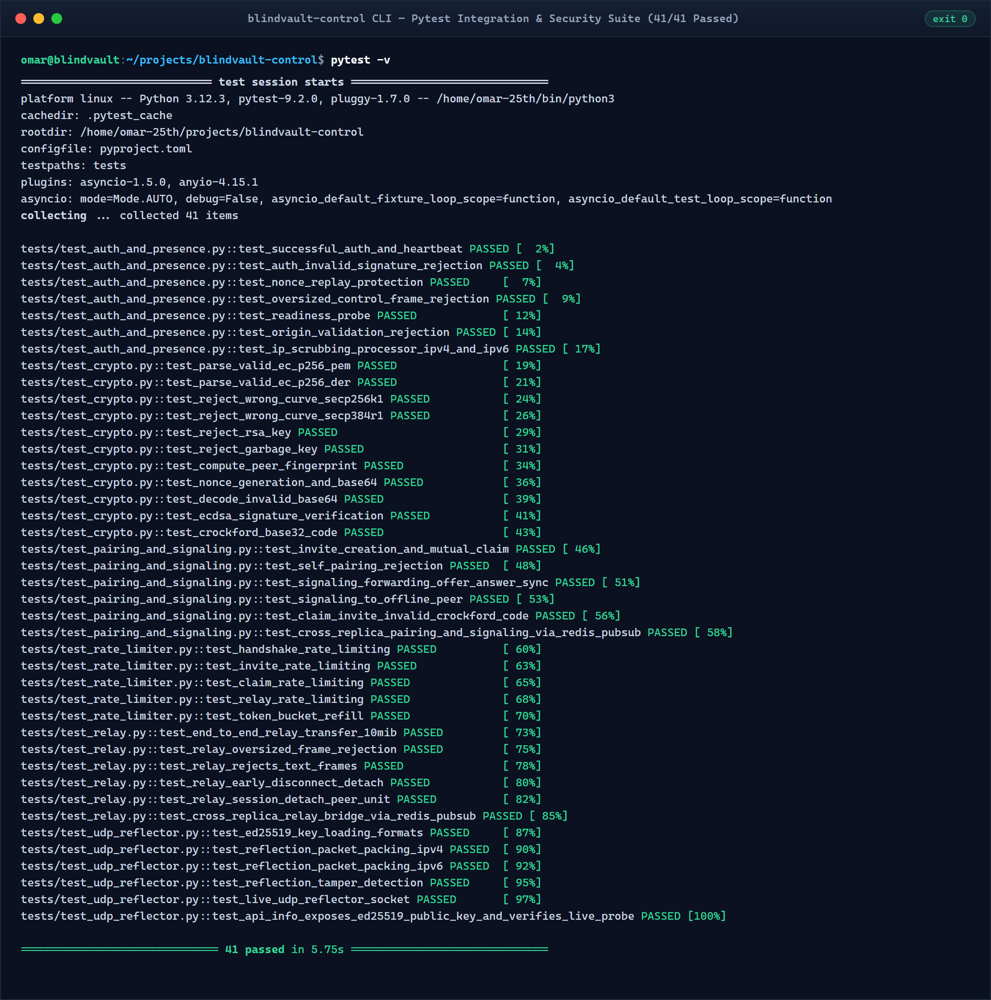
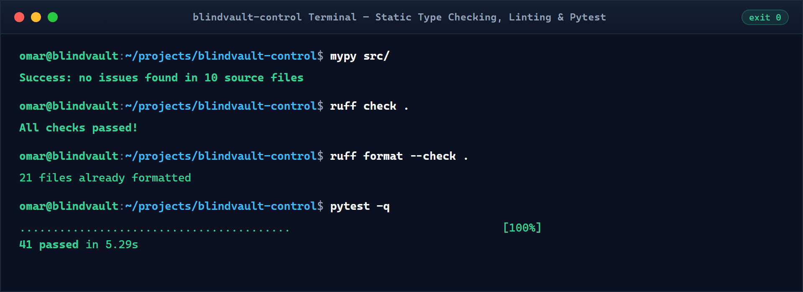

<p align="left">
  
</p>

# BlindVault Control Plane (`blindvault-control`)

[](https://www.python.org/downloads/)
[](https://fastapi.tiangolo.com)
[](https://opensource.org/licenses/MIT)
[](https://github.com/astral-sh/ruff)
[](https://mypy-lang.org/)

A production-grade, zero-knowledge control plane, NAT-traversal signaling server, and encrypted fallback relay for **BlindVault** (a peer-to-peer encrypted file transfer system).

---

## Architecture & Zero-Knowledge Philosophy

`blindvault-control` is engineered under strict zero-knowledge and privacy-preserving constraints:

1. **Zero-Knowledge State:** The server never inspects, logs, or persists filenames, file sizes, payload bytes, transfer histories, or social graphs.
2. **Ephemeral In-Memory State:** All presence, active challenge nonces, and pairing invites reside strictly in **Redis** with short TTL expiration (30s to 300s). No persistent disk writes occur on state servers.
3. **Cryptographic Identity:** Peer identities are **EC P-256** (`secp256r1`) public keys. Canonical peer IDs are lowercase hex **SHA-256 fingerprints** of the DER-encoded public key.
4. **Replay-Proof Authentication:** Server-issued 32-byte cryptographic nonces are stored in Redis and atomically retrieved and deleted (`GETDEL`) upon authentication, making replay attacks cryptographically impossible.
5. **Opaque Relay Streams:** Relay sessions treat all traffic as opaque ciphertext streams, preserving BlindVault's end-to-end **mutual TLS 1.3** session inside the tunnel.
6. **Async-First Concurrency:** Non-blocking `asyncio` across FastAPI WebSockets, raw UDP reflection sockets (`asyncio.DatagramProtocol`), and Redis operations.

```
                      +---------------------------------------+
                      |       blindvault-control              |
                      |                                       |
                      |   +-------------------------------+   |
                      |   |    UDP Reflector (Port 3478)  |   |
                      |   |  - STUN-like Endpoint Mapping |   |
                      |   |  - Ed25519 Signed Responses   |   |
                      |   +-------------------------------+   |
                      |                                       |
                      |   +-------------------------------+   |
                      |   |  WebSocket Control (/ws/control)  |
                      |   |  - ECDSA-SHA256 Auth & Nonces |   |
                      |   |  - Crockford Base32 Pairing   |   |
                      |   |  - ICE / Hole-Punch Signaling |   |
                      |   +---------------+---------------+   |
                      |                   |                   |
                      |   +---------------v---------------+   |
                      |   |  Encrypted Relay (/ws/relay)  |   |
                      |   |  - 64 KiB Backpressure Stream |   |
                      |   |  - Opaque mTLS Ciphertext     |   |
                      |   +---------------+---------------+   |
                      +-------------------|-------------------+
                                          |
                               +----------v----------+
                               |     Redis 7+        |
                               |  - Ephemeral TTLs   |
                               |  - Lua Rate Limiter |
                               +---------------------+
```

---

## Core Components

### 1. Cryptographic Identity & Auth (`crypto.py`, `signaling.py`)
- Peer connects to `WS /ws/control` and submits a `HELLO` message with its PEM-encoded EC P-256 public key.
- Server validates that the curve is `SECP256R1` (rejecting RSA, `secp256k1`, `secp384r1`, etc.).
- Computes `fingerprint = sha256(public_key_der).hexdigest()`.
- Generates a 32-byte cryptographically secure nonce (`secrets.token_bytes(32)`) and stores `nonce:{fingerprint}` with a 30s TTL.
- Peer responds with `AUTH` containing an ECDSA-SHA256 signature over the raw nonce bytes.
- Server atomically fetches and deletes the nonce via `GETDEL`, verifies the signature, and records active peer presence with a 60s TTL refreshed by heartbeats.

### 2. Ephemeral Out-of-Band Pairing (`redis_store.py`, `signaling.py`)
- Authenticated peers request `CREATE_INVITE` to generate an 8-character **Crockford Base32** pairing code (excluding confusing characters like `I`, `L`, `O`, `U`).
- Code is saved in Redis (`invite:{code}`) with a 300s TTL and bound to the creator's fingerprint and endpoint hints.
- A peer claims the code via `CLAIM_INVITE`. The server atomically consumes the code (`GETDEL`), checks against self-pairing, and notifies both parties with mutual `PEER_MATCHED` envelopes to initiate direct P2P connection.

### 3. UDP Endpoint Reflector (`udp_reflector.py`)
- Async UDP server listening on port `3478` (`asyncio.DatagramProtocol`).
- Peer fetches the reflector's public Ed25519 key from `GET /api/v1/info` (`udp_reflector_public_key`, base64 raw 32B key).
- Peer sends a 20-byte probe: `Magic (4B: b"BVST", 0x42565354) + Client Nonce (16B)`.
- Server reflects back:
  ```
  [0:4]        Magic (0x42565354 / b"BVST")
  [4:20]       Client Nonce (16B)
  [20]         Address Family (1B uint8: 4=IPv4, 6=IPv6)
  [21:21+L]    Observed IP bytes (L=4 for IPv4, L=16 for IPv6)
  [21+L:23+L]  Observed Port (2B uint16 big-endian)
  [23+L:31+L]  Server Epoch Timestamp (8B uint64 big-endian)
  [31+L:95+L]  Ed25519 Signature (64B) over [0:31+L]
  ```
- Peers asymmetrically verify the Ed25519 signature using `udp_reflector_public_key` without possessing any server secret.

### 4. Direct Hole-Punch Signaling & Horizontal Scaling (`signaling.py`)
- Matched peers exchange direct connection candidates over the WebSocket control channel:
  - `SIGNAL_OFFER`: Session description / ICE candidates
  - `SIGNAL_ANSWER`: Responsive session description / ICE candidates
  - `HOLE_PUNCH_SYNC`: Coordinated timestamp sync for synchronized UDP/TCP hole punching
- **Horizontal Scaling via Redis Pub/Sub:** Each replica subscribes to `bv:peer:{fingerprint}` for locally connected peers and publishes cross-replica signaling (`PEER_MATCHED`, `SIGNAL_*`, `HOLE_PUNCH_SYNC`, `RELAY_INVITE`) over Redis Pub/Sub.

### 5. Encrypted Fallback Relay (`relay.py`)
- When NAT traversal or direct hole-punching fails, peers fall back to the relay:
  - Peer requests `CREATE_RELAY` for a target peer fingerprint.
  - Server issues a single-use `token` (30s TTL) strictly bound to `(initiator, responder)` and notifies the responder via `RELAY_INVITE`.
  - Both peers connect to `WS /ws/relay/{session_id}` (passing `Authorization: Bearer <token>`).
  - If both peers land on the same replica, an in-memory bidirectional pipe bridges them; if they land on different replicas behind a load balancer, binary frames are bridged seamlessly across replicas over Redis Pub/Sub (`bv:relay:{session_id}:a2b` and `b2a`).
  - Strict 64 KiB frame limit, backpressure via `await websocket.send_bytes(...)`, 15-minute maximum session lifetime, and 30-second idle timeout.
  - Sockets and Redis state are immediately cleaned up upon disconnect or error.
  - Zero inspection of payload bytes: peer streams are opaque ciphertext carrying BlindVault's end-to-end mTLS 1.3 session.

### 6. Atomic Redis Lua Rate Limiting (`rate_limiter.py`)
- Token-bucket rate limiting implemented directly in atomic Redis Lua scripts:
  - Handshake attempts: max 10/min per client IP.
  - Invite creations: max 10/min per peer fingerprint.
  - Relay creations: max 5/min per peer fingerprint.
- WebSocket frame sizes strictly enforced (8 KiB on control, 64 KiB on relay) with standard RFC 6455 close codes (`1008` Policy Violation, `1009` Message Too Big).
- Automatic IPv4 scrubbing in logs for GDPR/privacy compliance.

---

## Wire Protocol Reference

### Control Channel WebSocket (`/ws/control`)

All control messages are formatted as JSON envelopes: `{"type": "<MESSAGE_TYPE>", ...}` strictly matching [schemas.py](file:///z:/home/omar-25th/projects/BlindVault/blindvault-control/src/blindvault_control/schemas.py).

| Direction | Type | Payload Fields | Purpose |
| :--- | :--- | :--- | :--- |
| Client → Server | `HELLO` | `public_key`, `observed_endpoint` (optional) | Initiate authentication |
| Server → Client | `CHALLENGE` | `nonce` (base64, 32 bytes), `fingerprint` | Cryptographic challenge |
| Client → Server | `AUTH` | `signature` (base64 ECDSA signature) | Complete authentication |
| Server → Client | `AUTH_OK` | `fingerprint`, `heartbeat_interval_sec` | Session authenticated |
| Server → Client | `AUTH_FAILED`| `reason` | Auth failure |
| Client ↔ Server | `PING` / `PONG` | *(empty)* | Keepalive / presence refresh |
| Client → Server | `CREATE_INVITE` | `endpoints` (optional list of endpoint dicts) | Request Crockford Base32 invite code |
| Server → Client | `INVITE_CREATED`| `code`, `ttl` | Invite code issued |
| Client → Server | `CLAIM_INVITE`  | `code`, `endpoints` (optional list of endpoint dicts) | Redeem invite code |
| Server → Client | `PEER_MATCHED`  | `peer_fingerprint`, `endpoints`, `role` (`creator` \| `claimer`) | Mutual peer match notifications |
| Client ↔ Client | `SIGNAL_OFFER`  | `target_fingerprint`, `session_id`, `candidate` | Forward ICE/P2P offer |
| Client ↔ Client | `SIGNAL_ANSWER` | `target_fingerprint`, `session_id`, `candidate` | Forward ICE/P2P answer |
| Client ↔ Client | `HOLE_PUNCH_SYNC`| `target_fingerprint`, `stage`, `timestamp` (optional) | Synchronized hole-punch timing |
| Client → Server | `CREATE_RELAY`  | `target_fingerprint` | Request fallback relay session |
| Server → Client | `RELAY_CREATED` | `session_id`, `token` | Initiator relay rendezvous details |
| Server → Client | `RELAY_INVITE`  | `session_id`, `from_fingerprint`, `token` | Target peer relay invite |
| Server → Client | `ERROR`         | `code`, `message` | Operation error notice |

### Relay WebSocket (`/ws/relay/{session_id}`)

- **Authentication:** `Authorization: Bearer <token>` or `X-Relay-Token: <token>` HTTP header (or query param `?token=<token>`).
- **Framing:** Binary frames only (max 64 KiB). Text frames are strictly rejected with WebSocket close code `1003` (Unsupported Data). The server transparently forwards raw bytes between attached peers.

---

## Configuration

Settings can be overridden via environment variables or a `.env` file (prefixed with `BLINDVAULT_`):

| Variable | Default | Description |
| :--- | :--- | :--- |
| `BLINDVAULT_ENVIRONMENT` | `development` | Runtime environment (`development`, `test`, `production`) |
| `BLINDVAULT_HOST` | `0.0.0.0` | HTTP/WebSocket bind address |
| `BLINDVAULT_PORT` | `8000` | HTTP/WebSocket bind port |
| `BLINDVAULT_ALLOWED_ORIGINS` | `[]` | Allowed WebSocket Origin headers (empty rejects browser origins) |
| `BLINDVAULT_UDP_HOST` | `0.0.0.0` | UDP STUN reflector bind address |
| `BLINDVAULT_UDP_PORT` | `3478` | UDP STUN reflector bind port |
| `BLINDVAULT_UDP_SIGNING_PRIVATE_KEY` | *(auto-generated)* | Ed25519 private key (PEM, 64-hex seed, or base64 raw 32B) for reflector signatures |
| `BLINDVAULT_REDIS_URL` | `redis://localhost:6379/0` | Redis connection URL |
| `BLINDVAULT_RATE_LIMIT_HANDSHAKE_PER_MIN` | `10` | Max handshakes per minute per IP |
| `BLINDVAULT_RATE_LIMIT_INVITE_PER_MIN` | `10` | Max invites per minute per fingerprint |
| `BLINDVAULT_RATE_LIMIT_CLAIM_PER_MIN` | `10` | Max claims per minute per fingerprint / IP |
| `BLINDVAULT_RATE_LIMIT_RELAY_PER_MIN` | `5` | Max relays per minute per fingerprint |
| `BLINDVAULT_RELAY_MAX_SESSION_SECONDS` | `900` | Max relay session lifetime (15 min) |
| `BLINDVAULT_RELAY_IDLE_TIMEOUT_SECONDS` | `30` | Idle timeout before terminating relay |
| `BLINDVAULT_RELAY_MAX_FRAME_BYTES` | `65536` | Max binary frame size (64 KiB) |
| `BLINDVAULT_CONTROL_MAX_FRAME_BYTES` | `8192` | Max control message size (8 KiB) |
| `BLINDVAULT_PRESENCE_TTL_SECONDS` | `60` | Presence TTL in Redis |
| `BLINDVAULT_CHALLENGE_TTL_SECONDS` | `30` | Challenge nonce TTL |
| `BLINDVAULT_INVITE_TTL_SECONDS` | `300` | Pairing invite TTL |
| `BLINDVAULT_RELAY_TOKEN_TTL_SECONDS` | `30` | Single-use relay token TTL |
| `BLINDVAULT_HEARTBEAT_INTERVAL_SECONDS` | `20` | Recommended heartbeat interval |
| `BLINDVAULT_LOG_LEVEL` | `INFO` | Logging level (`DEBUG`, `INFO`, `WARNING`, `ERROR`) |
| `BLINDVAULT_SCRUB_IPS_IN_LOGS` | `true` | Anonymize IPv4 & IPv6 addresses in structured JSON logs |

---

## Quickstart

### 1. Local Development Setup

```bash
# Clone repository
cd blindvault-control

# Install dependencies (Python 3.12+)
pip install -e ".[dev]"

# Run tests
pytest -v

# Run type checker and linter
mypy src/
ruff check .
ruff format --check .

# Start control plane locally
blindvault-control
```

### 2. Running with Docker Compose

A complete stack with Redis 7 Alpine (in-memory mode, no persistence on disk) and `blindvault-control`:

```bash
docker compose up --build
```

Endpoints exposed:
- HTTP / WebSocket: `http://localhost:8000` (Health check: `http://localhost:8000/health`)
- UDP Endpoint Reflector: `udp://localhost:3478`

---

## Test Suite

The test suite utilizes `fakeredis[lua]` to execute deterministic, hermetic tests of all cryptographic flows, race conditions, and Lua rate limiters:

```bash
pytest -v
```

### Test Coverage (41/41 Passing)

- **`test_crypto.py`** (11 tests): EC P-256 parsing (PEM and DER), curve verification (`SECP256R1`), rejection of rogue curves (`secp256k1`, `secp384r1`, RSA, garbage), SHA-256 fingerprinting, nonce generation, base64 encoding/decoding, ECDSA signature verification, Crockford Base32 generation and validation.
- **`test_auth_and_presence.py`** (7 tests): Full challenge-response handshake, periodic PING/PONG heartbeats, invalid signature rejection, nonce replay prevention, oversized frame rejection (`1009`), `/ready` probe, Origin validation, IPv4/IPv6 log scrubbing.
- **`test_pairing_and_signaling.py`** (6 tests): Ephemeral invite creation, mutual claim (`PEER_MATCHED`) with zero server IP leak, invalid Crockford code handling, self-pairing rejection, P2P signaling routing, cross-replica pairing & signaling over Redis Pub/Sub.
- **`test_udp_reflector.py`** (6 tests): Ed25519 key loading, binary packet encoding/decoding for IPv4 and IPv6, Ed25519 signature verification, tamper detection, live UDP socket reflection, `/api/v1/info` public key exposure.
- **`test_relay.py`** (6 tests): End-to-end 10 MiB binary stream transfer with SHA-256 verification, oversized frame rejection, text frame rejection (`1003`), early disconnect detach & teardown, unit lifecycle, cross-replica Redis Pub/Sub relay bridge.
- **`test_rate_limiter.py`** (5 tests): IP handshake, invite creation, invite claim, relay creation rate limiting, and simulated-clock token-bucket refill.

### Verified CLI & Terminal Test Runs

| Pytest Verbose Suite (`pytest -v`, 41/41) | Type Checking, Linting & Pytest (`mypy`, `ruff`, `pytest -q`) |
| :---: | :---: |
|  |  |

---

## Performance Benchmarks

Benchmarks were measured using `benchmarks/bench_control.py` on an 8-core CPU workload:

| Benchmark Metric | Workload / Scenario | Measured Result |
| :--- | :--- | :--- |
| **ECDSA Challenge-Response Handshakes** | 500 handshakes (25 concurrent workers) | **185 – 312 handshakes/s** |
| **Handshake Latency (p50)** | 25 concurrent workers | **73.8 ms – 131.8 ms** |
| **Handshake Latency (p95)** | 25 concurrent workers | **108.8 ms – 190.4 ms** |
| **Handshake Latency (p99)** | 25 concurrent workers | **109.3 ms – 191.4 ms** |
| **Concurrent Authenticated WS Sessions** | Zero-knowledge idle peers | **500 concurrent peers (100% success)** |
| **Heartbeat Fan-out Ping Latency (p50)** | 500 connected peers | **135.2 ms** |
| **Heartbeat Fan-out Ping Latency (p95)** | 500 connected peers | **150.1 ms** |
| **Encrypted Fallback Relay Throughput** | 100 MiB stream (64 KiB chunks) | **8.31 – 9.60 MiB/s (~70 – 80.5 Mbps)** |
| **Relay End-to-End Data Integrity** | SHA-256 verification | **100% match (zero corrupt bytes)** |

To run the benchmark suite locally:
```bash
python benchmarks/bench_control.py
```

---

## Security Considerations

1. **Private Key Storage:** The server never receives or handles peer private keys. Authentication is strictly zero-knowledge via digital signatures over ephemeral server nonces.
2. **Curve Confusion Protection:** The parser explicitly verifies the key curve is `secp256r1`. Other curves (e.g. `secp256k1`, `secp384r1`) are rejected immediately before fingerprint calculation.
3. **Replay & Timing Attacks:** Nonces are 32 cryptographically random bytes generated via `secrets.token_bytes(32)`. Redis `GETDEL` ensures every nonce can only be consumed once.
4. **Relay Isolation:** Fallback relay tokens are single-use and bound exclusively to the designated `(initiator, responder)` pair. Unmatched tokens or third-party connections are rejected.
5. **PII Anonymization:** Client IP addresses are scrubbed from server logs when `BLINDVAULT_SCRUB_IPS_IN_LOGS=true`.
